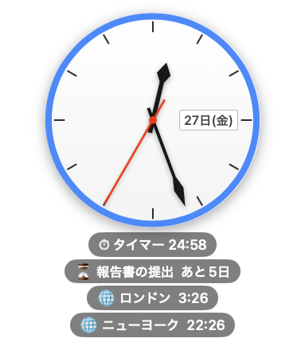
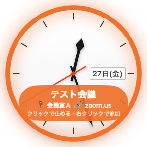
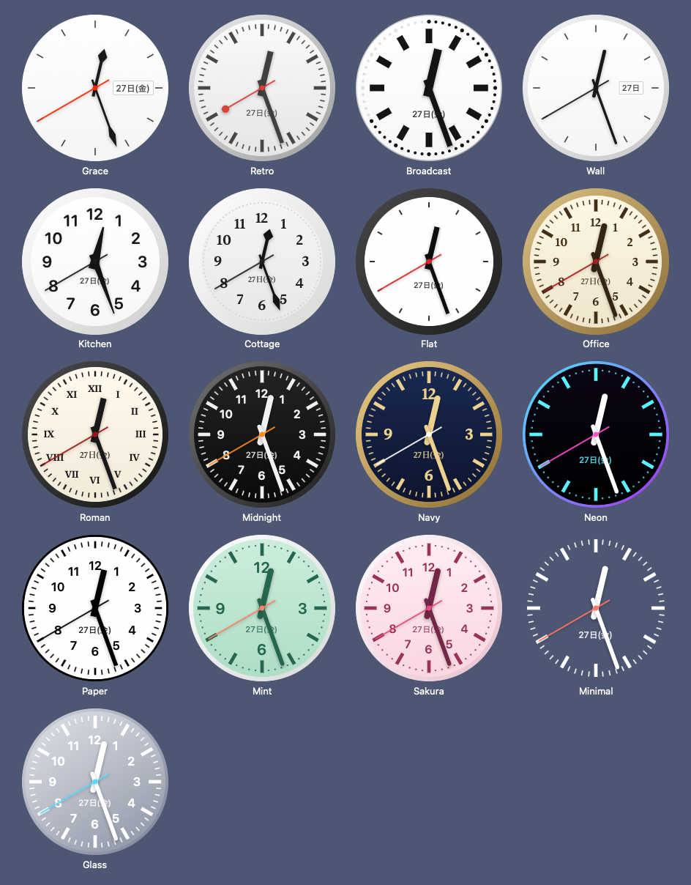
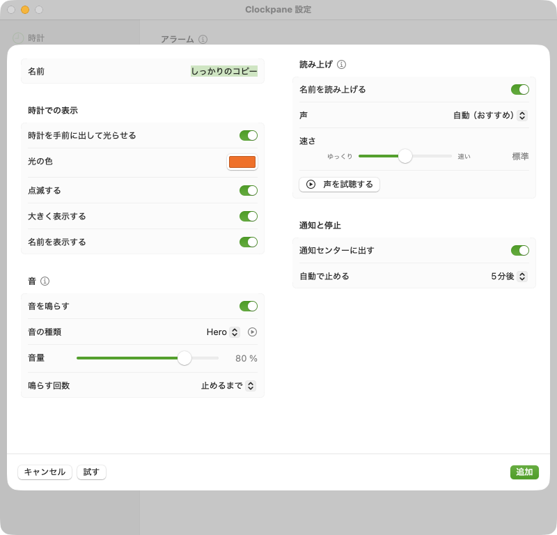
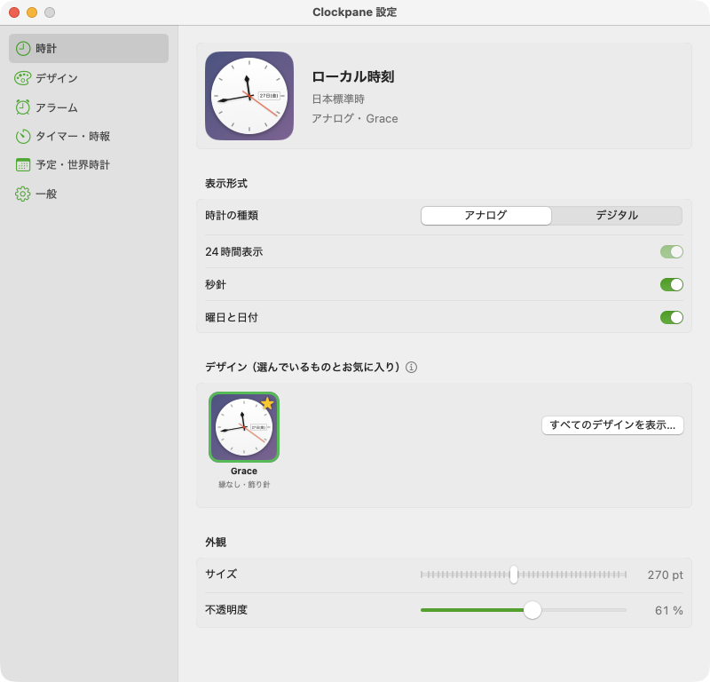

# Clockpane

**A clock for your macOS desktop.** It can also show alarms, a timer, Pomodoro sessions, your next calendar event, and world clocks.

[日本語](README.md)

<p align="center">
  
  
</p>

## Download

**[Download Clockpane.dmg](https://github.com/deskcraft/clockpane/releases/latest/download/Clockpane.dmg)** (latest version)

- Requires macOS 15 or later (Apple silicon or Intel)
- Earlier versions: [Releases](https://github.com/deskcraft/clockpane/releases)

### Install
1. Open the downloaded `Clockpane.dmg`.
2. Drag **Clockpane** to **Applications**.

### Opening for the first time
This app is not signed or notarized by Apple, so the first launch needs these steps:

1. Open Clockpane from Applications. When macOS says it couldn’t verify the app, click **Done**.
2. Open **System Settings → Privacy & Security**, scroll down, and click **Open Anyway** next to the message about Clockpane.
3. Open Clockpane again and click **Open Anyway** when asked.

After that, it opens normally.

<details>
<summary>Using Terminal instead</summary>

```bash
xattr -dr com.apple.quarantine /Applications/Clockpane.app
```
This removes the “downloaded from the internet” mark. Run it, then open the app.
</details>

## Features

### Clock
- Analog or digital, 12/24-hour time, seconds, date and weekday
- **17 designs**, plus **your own designs** with custom rim, face, marks, numbers, hands and date (☆ to favorite)
- Size and opacity, always on top, drag to move
- Hover over the center of the clock to show a handle that opens a menu right there. Clicks anywhere else pass through the clock, so it never gets in your way.

<p align="center"></p>

### Alarms and alert styles
- Time, name, repeat (once, every day, weekdays, chosen days), snooze
- Combine **alert styles**: glow, blink or enlarge the clock, sound (type, volume, repeats), Notification Center, speech (voice and speed)
- Standard (Recommended), Quiet and Strong are built in, and you can create your own (☆ to favorite)

<p align="center"></p>

### Timer, Pomodoro and chime
- Quick timers (1 min to 1 hour) or any length. Remaining time shows as a ring on the clock and below it
- Pomodoro (25-min focus, 5-min break, a long break every 4 sessions; all adjustable)
- Hourly or half-hourly chime, with an option to stay quiet at night

### Calendar, world clock and deadlines
- Shows the next event from the Mac’s Calendar (including synced accounts such as Google Calendar) and alerts you before it starts
- Shows the event’s **location** and **meeting link** (Zoom, Teams, Google Meet and more); join with one click from the notification
- Time in up to 4 other cities, and days left until your nearest deadline

### Other
- Japanese and English, open at login, show or hide the Dock icon

<p align="center"></p>

## Permissions
| Permission | Used for | Asked when |
|---|---|---|
| Notifications | Showing alerts in Notification Center | You first use an alert style with notifications |
| Calendars | Showing the next event and alerting before it | You turn on “Show the next event below the clock” |

Calendar events are read only on your Mac and are never sent anywhere.

## Build from source
See [docs/DEVELOPMENT.md](docs/DEVELOPMENT.md) (in Japanese).

```bash
git clone https://github.com/deskcraft/clockpane.git
cd clockpane
./build.sh install
```

## Feedback
Please open an [issue](https://github.com/deskcraft/clockpane/issues).

## License
[MIT License](LICENSE)
