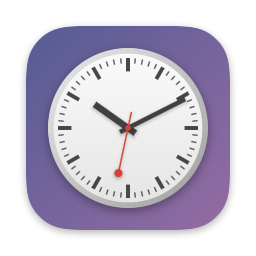
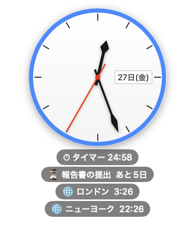
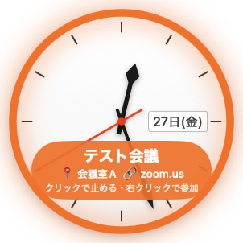
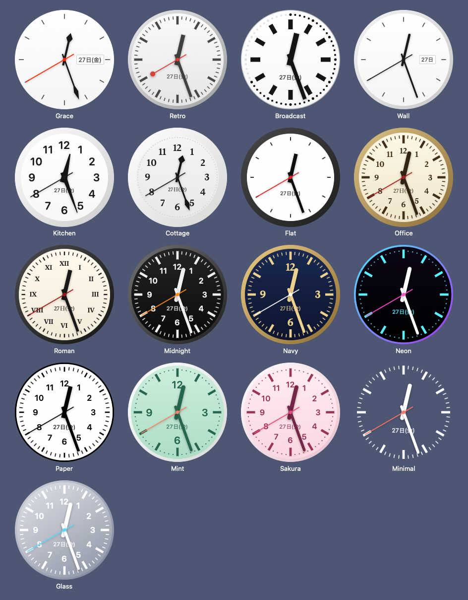
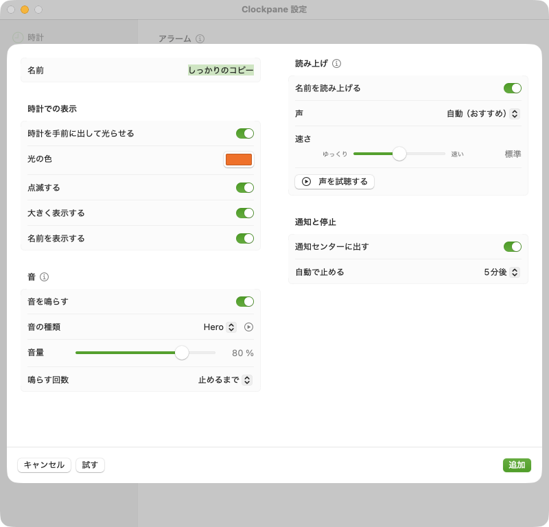
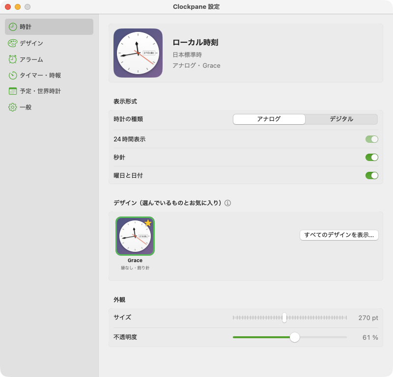

#  Clockpane

**macOS のデスクトップに置く時計アプリ**です。アラーム、タイマー、ポモドーロ、カレンダーの次の予定、世界時計もまとめて表示できます。

[English](README.en.md)

<p align="center">
  
  
</p>

## ダウンロード

**[Clockpane.dmg をダウンロード](https://github.com/deskcraft/clockpane/releases/latest/download/Clockpane.dmg)**（最新版）

- 動作環境：macOS 15 以降（Apple シリコン・Intel どちらの Mac でも動きます）
- これまでの版：[Releases](https://github.com/deskcraft/clockpane/releases)

### インストール
1. ダウンロードした `Clockpane.dmg` を開きます。
2. **Clockpane** を **「アプリケーション」** にドラッグします。

### 初めて開くとき
このアプリは Apple の有料の署名（公証）をしていないため、初めて開くときだけ次の手順が必要です。

1. 「アプリケーション」の Clockpane を開きます。「Apple は…確認できませんでした」と出たら **「完了」** を押します。
2. **システム設定 →「プライバシーとセキュリティ」** を開き、下のほうにある「Clockpane は…ブロックされました」の横の **「このまま開く」** を押します。
3. もう一度 Clockpane を開き、確認が出たら **「このまま開く」** を押します。

2回目からは、ふつうに開けます。

<details>
<summary>ターミナルを使う方法</summary>

```bash
xattr -dr com.apple.quarantine /Applications/Clockpane.app
```
ダウンロードしたファイルに付く「インターネットから来た」という印を外します。実行してから開いてください。
</details>

## できること

### 時計
- アナログとデジタル、12/24 時間表示、秒、曜日と日付
- **17 種類のデザイン**と、縁・盤面・目盛り・数字・針・日付まで変えられる**自作デザイン**（☆でお気に入り）
- サイズと不透明度、常に手前に表示、ドラッグで移動
- 時計の中心にマウスを乗せると出る「つまみ」から、その場でメニューを開けます。つまみ以外のクリックは時計を素通りするので、作業の邪魔になりません。

<p align="center"></p>

### アラームと知らせ方
- 時刻・名前・繰り返し（1回だけ／毎日／平日／曜日）・スヌーズ
- **知らせ方**を組み合わせて選べます：時計を光らせる・点滅・拡大、音（種類・音量・回数）、通知センター、読み上げ（声・速さ）
- 「標準（推奨）」「静か」「しっかり」が最初から入っていて、自分用の知らせ方も作れます（☆でお気に入り）

<p align="center"></p>

### タイマー・ポモドーロ・時報
- よく使う時間（1分〜1時間）か好きな時間のタイマー。残り時間は時計の縁の輪と時計の下に表示
- ポモドーロ（作業 25 分・休憩 5 分、4 回ごとに長い休憩。時間は変えられます）
- 毎正時／30 分ごとの時報（夜は鳴らさない設定あり）

### 予定・世界時計・締切
- Mac の「カレンダー」の次の予定（Google カレンダーなどを同期していれば、それも）を表示し、始まる前に知らせます
- 予定の**場所**と **Zoom・Teams・Google Meet などの会議リンク**を表示し、通知の「参加する」ですぐ参加できます
- ほかの都市の時刻（4 つまで）、一番近い締切までの日数

### そのほか
- 日本語と英語の切り替え、ログイン時に起動、Dock への表示の切り替え

<p align="center"></p>

## 使うときの許可
| 許可 | 使う機能 | 求められるとき |
|---|---|---|
| 通知 | 通知センターに知らせを出す | 通知を使う知らせ方を初めて使ったとき |
| カレンダー | 次の予定の表示と事前の知らせ | 「次の予定を時計の下に表示する」をオンにしたとき |

カレンダーの予定は Mac の中で読むだけで、外部には送りません。

## ソースからビルドする
開発者向けの説明は [docs/DEVELOPMENT.md](docs/DEVELOPMENT.md) にあります。

```bash
git clone https://github.com/deskcraft/clockpane.git
cd clockpane
./build.sh install
```

## 不具合の報告・要望
[Issues](https://github.com/deskcraft/clockpane/issues) にお寄せください。

## ライセンス
[MIT License](LICENSE)
